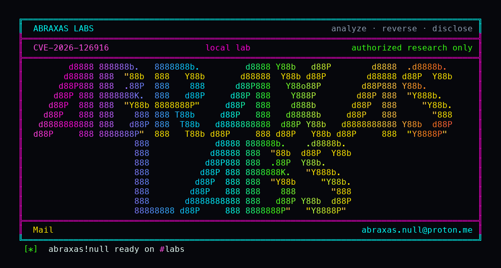

<p align="center">
  
</p>

# chrome-icu-usearch-ce-overflow

You open a page. The page is mostly one Arabic ligature, over and over, and
then a short run of the letter A. Chrome's find-in-page walks that string
with ICU `usearch`. The search collator turns each ligature into 18 collation
elements. The index is an `int32_t`. After 119,304,647 ligatures it wraps.
Vulnerable Chrome dies in the renderer. That is CVE-2026-126916.

Google called it High: integer overflow in V8's neighborhood, reached from
Blink `window.find`, "arbitrary code inside the sandbox." Chrome 157.0.8103.78
closed it on 11 November 2026. This pack is the crash, not a shell.

**Class:** Integer overflow (CWE-190) leading to renderer SIGSEGV
**Reach:** Remote, crafted web content

| | |
|---|---|
| ID | [CVE-2026-126916](https://www.cve.org/CVERecord?id=CVE-2026-126916) |
| Class | **Integer overflow** (CWE-190) |
| Reach | **Remote** (crafted HTML, `window.find`) |
| Product | [Google Chrome](https://www.google.com/chrome/) / ICU usearch |
| Affected | Chrome before 157.0.8103.78 (Windows/Mac 157.0.8103.78/.79, Linux 157.0.8103.78) |
| Fixed | Chrome 157.0.8103.78, ICU CL 8668040 (`I982b1d76cdbc03b2d357d53dba32ce49ef505c4c`), bug 574025697 |
| Chrome rating | High |
| Auth | none |
| License | [GNU Affero GPL v3.0](LICENSE) |
| Lab | local Docker, linux-arm64 Chrome for Testing |

## What an attacker can do

| Method | Sink | Result |
|---|---|---|
| Huge `U+FDFA` corpus plus a 65-character `A` needle, then `window.find` | ICU `CEIBuffer::get` / `usearch_search` `int32_t` CE index | **Lab-proven:** Chrome 157.0.8103.50 renderer minidump exception `0xb` (SIGSEGV). 157.0.8103.78 finds the needle at `119333774..119333839` and stays up |
| Same overflow with a controlled remaining buffer | negative ring-buffer subscript | **Inferred from the patch.** Signed wrap past `INT32_MAX` is a classic write primitive. Not demonstrated here |
| Renderer RCE | sandboxed renderer | **Not attempted.** No exploit payload. Google rates the class as code exec inside the sandbox |
| Browser-process compromise | sandbox escape | **Closed for this bug.** This is renderer/ICU only |

The in-tree witness is ICU `StringSearchTest::TestCEIndexOverflow` (ICU-23568). `U+FDFA` is 18 primary CEs. `119304647 * 18 == INT32_MAX - 1`. The 65 `A`s sit just past that index.

## Why the index wrapped

`CEIBuffer::get()`, `getPrevious()`, `usearch_search()`, and
`usearch_searchBackwards()` tracked collation-element indexes in `int32_t`.
Past `INT32_MAX` processed CEs the index went negative and the ring buffer
was indexed off the front. CL 8668040 (cherry-picked into Chromium's ICU)
widens those indexes to `int64_t`.

Chromium issue 574025697 stays restricted. The ICU patch is public.

## The lab

Two Chrome for Testing builds. Smoke find of 5,000 ligatures first, then the
full 119,304,647 corpus. Newlines every 4,096 characters keep Blink shaping
in chunks. They stay in one block, so `window.find` still runs one `usearch`.

```bash
python3 chrome-icu-usearch-ce-overflow-Abraxas-Labs.py
```

or:

```bash
cd lab && ./run.sh
```

The full find takes about a minute on the patched pin and needs a few GB of
RAM for the string. Last proven line:

```
SUCCESS CVE-2026-126916 vuln-crash CVE-2026-126916-INTOF-WITNESS
```

Image `cve-2026-126916:lab`, compose project `cve126916`, loopback
`127.0.0.1:18650`. Host is linux-arm64 Docker (Apple Silicon).

| File | Purpose |
|---|---|
| `lab/poc.js` | builds the ICU overflow corpus and calls `window.find` |
| `lab/poc.html` | host page |
| `lab/poc.py` | CFT, minidump watch, differential crash vs match |

Abraxas Labs
abraxas.null@proton.me
